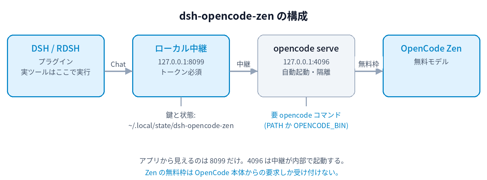

# dsh-opencode-zen

[English](<README.en.md>) ・ [MIT](<LICENSE>) ・ [監査メモ](<AUDIT.md>)

OpenCode Zen の**無料モデル専用**のDSHプラグイン。素の `dsh` でもRDSHでも動きます。



## 必要なもの

| 必要なもの | 理由 |
|---|---|
| **`opencode` コマンド** | **必須**。Zenの無料枠は「OpenCode本体からの要求」しか受け付けません。中継がこれを上流クライアントとして自動起動します。`PATH` にあるか `OPENCODE_BIN=/path/to/opencode` |
| Linux / Node 22.19以上 | 中継に必要（systemdは任意） |
| `pnpm` | プラグインマネージャが使用。`install.sh` は `corepack` で自動有効化を試み、無理なら `npm i -g pnpm` を案内します |

OpenCodeを入れたくない場合、このプラグインは使えません。DSH標準のプロバイダ（`deepseek-official` や `opencode-go` など）を使ってください。

プロファイルが無い環境では、`install.sh` が `dsh plugin` にプロファイル作成を任せます（手動準備は不要）。
systemdが無い環境（コンテナ等）では中継をバックグラウンドで起動します。

## ポート

| ポート | 用途 | 変更 |
|---|---|---|
| **8099** | アプリが見る唯一の窓口（ローカル中継）。トークン必須 | `PROXY_PORT` |
| 4096 | 中継が内部で起動する専用OpenCode。直接使う必要なし | `OC_PORT` |
| — | 鍵と状態の置き場（0600） | `FREEMODELS_RUNTIME_DIR` |

既定は `8099` と `4096`、状態は `~/.local/state/dsh-opencode-zen`。ポートを変えるときは `dsh-opencode-zen-setup` に `--base-url http://127.0.0.1:<PROXY_PORT>/v1` も渡してください。

## インストール

```bash
curl -fsSL https://raw.githubusercontent.com/kuraneko1/dsh-opencode-zen/main/install.sh | bash
```

| 変更したい | やり方 |
|---|---|
| 別プロファイル | `PROFILE=tui bash install.sh` |
| サービス化しない | `SERVICE=0 bash install.sh` |
| OpenCodeの場所を指定 | `OPENCODE_BIN=/opt/opencode/opencode bash install.sh` |
| 中継を止める | `systemctl --user disable --now dsh-opencode-zen.service` |

手動で入れる場合:

```bash
dsh plugin --profile web add https://github.com/kuraneko1/dsh-opencode-zen/releases/download/v0.2.21/dsh-opencode-zen-0.2.21.tgz
"${DSH_HOME:-$HOME/.dsh}/profiles/web/node_modules/.bin/dsh-opencode-zen-setup" --install --profile web --service
```

インストール後、モデル選択で **OpenCode Zen（無料）** を選びます。既定モデルは変更しません。

## 無料枠には一度だけログインが必要

```bash
opencode auth login --provider opencode     # ブラウザでサインイン（1回だけ）
systemctl --user restart dsh-opencode-zen.service   # ログイン後に中継を再起動
```

`OpenCode's free tier can only be used from within OpenCode` という403は、**OpenCodeに資格情報が
保存されていないこと**を示します（公式issue #52917 が同じ結論で、修正手順としてログインを挙げています）。
未ログインだと本物のOpenCodeでも同じ403になります。

注意: issueにある `opencode auth login opencode` は**1.19系では動きません**（位置引数をURLとして扱うため
`fetch() URL is invalid` になります）。`--provider` を付けてください。

中継は保存された資格情報のうち **`opencode`（Zen/Console）の1件だけ** を専用クライアントに渡します。
他のプロバイダの資格情報はコピーしません。ログインしていない場合は匿名のまま起動し、警告を出します。

補足: 以前は匿名（資格情報なし）でも無料枠が使えましたが、提供元が匿名レーンを締めました。`opencode` プロバイダの
資格情報はOAuthではなく**APIキー**（`OPENCODE_API_KEY`）で、公式手順では[opencode.ai/auth](https://opencode.ai/auth)で
サインインしてキーを取得します（サインイン時に請求情報の登録を求められる場合があります。無料モデルは cost 0 です）。

## 403 FreeTierError が出るとき

まず診断してください（リレー経由で1回だけ実際に叩きます）:

```bash
node zen-doctor.mjs
```

分かったこと（2026-10-17 実測）: **同じアカウント・同じ版でも、回線の出口がIPv6だと通り、IPv4だと拒否されます。**
このホストはIPv4 `219.8.20.246` で拒否、z170-desktop はIPv6 `2402:6b00:…` で成功しました（クライアント偽装はしていません）。

- **IPv4と判定された場合** → 回線のIPv6を有効化するか、出口が受け入れられているホストの中継を使ってください:
  ```bash
  ssh -N -L 8099:127.0.0.1:8099 ryu@<そのホスト>     # 相手の中継をローカル8099へ
  ```
  DSH側の資格情報は**相手ホストの `proxy.key`** に合わせてください（`dsh-opencode-zen-setup --install --key-file <それ>`）。
- 資格情報（`opencode auth login --provider opencode`）が必要な場合もあります。匿名で通る回線もあるため、
  未設定でも即失敗とは限りません。
- それでも403なら提供元の判断です。このプラグインは回避しません。

### 「素のCLIは通るのに、リレー経由だけ403」になるとき

提供元のゲートは**回線の出口**を見ています（2026-10-17 実測: 同じアカウント・同じ版でも、IPv6の出口は受理、IPv4の出口は拒否）。
実際にこのホストでは有線接続が `ipv6.method=disabled` で IPv6 が無く、IPv4で出ていたため拒否されていました。手順は:

1. 回線を確認する
   ```bash
   ip -6 route show default          # 既定IPv6ルートが無ければIPv6が出ていない
   curl -6 https://api64.ipify.org   # 200 ならIPv6で出られている
   ```
2. 無ければ有効化する（例: NetworkManager）
   ```bash
   nmcli connection modify "<接続名>" ipv6.method auto
   nmcli device reapply <NIC>
   ```
3. **IPv6を後から有効にしたら、リレーを再起動する**
   ```bash
   systemctl --user restart dsh-opencode-zen.service
   ```
   専用OpenCodeは起動時に経路を決めるため、**後からIPv6が生えても自分では乗り換えません**（これが「素のCLIは通るのにリレーだけ403」の正体）。
   0.2.21 以降は、拒否が続いたうえでIPv6が新たに使えるようになったことを検知すると、**自動で専用OpenCodeを再起動**します。
4. 状態は `GET /health` で見られます: `egress.ipv6`（この機械がグローバルIPv6を持つか）と `refusals.count`（上流に403で拒否された累計）。

### ツールを付けないリクエストも通ります

上流のゲートは**ツールを持たないリクエストを拒否**します（実測: ツール無しは403、同じ内容でツール1個付きは200）。
DSHの通常のエージェント呼び出しは必ずツールを伴うので問題になりませんが、要約・タイトル生成のような内部呼び出しに備えて、
ツール無しのときは**最小のツール定義を1つだけ添えて**送り、返ってきたツール呼び出しは**呼び出し元に返さず落とします**
（呼び出し元はツールを要求していないため）。

## 知っておくこと

- **長いセッション**: `deepseek-v4.1-flash-free` と `glm-5.3-flash-free` は実測1M（999,312 / 1,047,653トークン）として宣言します。他モデルは公開値のまま
- **ツールなしの単発要求**は提供元が403 `FreeTierError` を返します。DSHは実際のツールを送るので通常利用は通ります
- **空のプロファイル**ではDSH自身の依存のビルド承認を求められることがあります（`pnpm approve-builds`）。このプラグインにビルドスクリプトはありません
- 認証付きloopback限定。Zenの資格情報（`opencode auth login --provider opencode` で保存するAPIキー）は**必要な回線と不要な回線があります**（匿名で通る例を実測）。中継は保存があれば `opencode` の1件だけ採用します（無料モデル自体は cost 0）
- 無料枠の継続・全モデル・将来バージョンは保証しません

詳しい制約は [AUDIT.md](<AUDIT.md>)、変更履歴は [CHANGELOG.md](<CHANGELOG.md>)。
